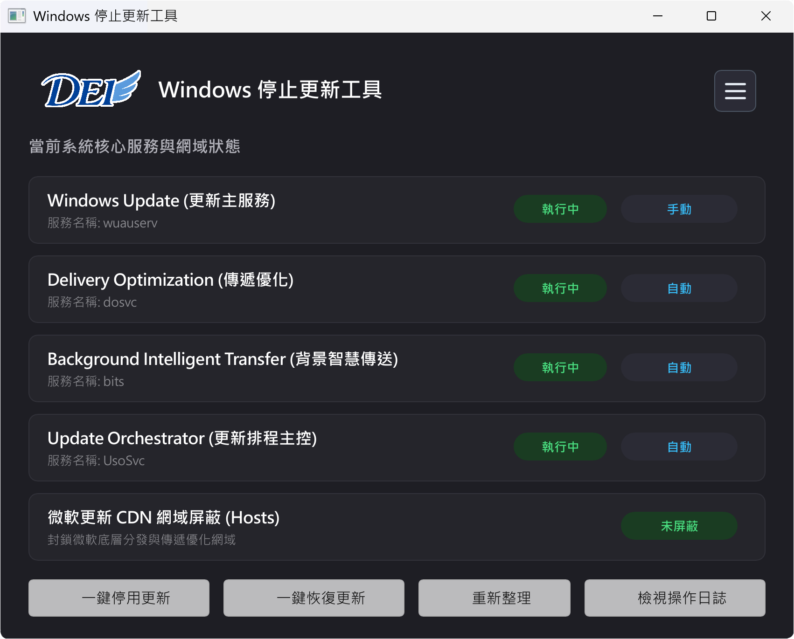

  

**繁體中文** · [简体中文](docs/readme/README_zh-CN.md) · [English](docs/readme/README_en.md)

# Windows 停止更新工具 (Stop Windows Update Tool)

### 徹底阻斷微軟自動更新 · 還給電腦純淨安定的工作環境
專為日常使用、電競遊戲、專業工作站與 WinPE 電腦維修環境打造

**告別強制重啟、頻寬占用與更新藍屏。五重防禦深度關閉 Windows Update，隨時一鍵無損還原！**

[軟體簡介](#-軟體簡介) · [功能介紹](#-功能介紹) · [軟體操作畫面](#-軟體操作畫面) · [下載與使用說明](#-下載與使用說明) · [系統需求](#-系統相容性與需求) · [常見問題](#-常見問題-faq) · [問題反饋](#-問題反饋與支援)

---

## 📖 軟體簡介

在進行重要的商業工作、電競對戰、線上直播或大型 3D 渲染時，微軟 Windows 的強制自動更新常帶來嚴重的困擾：
- 突如其來的自動重新啟動，導致未儲存的文件與專案毀於一旦。
- 背景 Delivery Optimization (傳遞優化) 與 BITS 瘋狂佔用網路頻寬與硬碟讀寫，造成系統延遲卡頓。
- 惱人的系統更新造成硬體驅動衝突、周邊印表機失效，甚至開機藍屏 (BSOD)。
- 系統反覆「死灰復燃」，即使手動在「服務」中關閉，微軟的醫療保健服務 (WaaSMedic) 又會在開機時自動強行重啟。
- 關機選單中頑固出現的「更新並關機」、「更新並重新啟動」幻影按鈕，讓人避無可避。

**「Windows 停止更新工具」** 是一款專為 Windows 10 / 11 / 8 / 7 使用者與電腦維修技術人員打造的原生綠色免安裝實用工具。結合**系統底層服務凍結**、**全量微軟更新 CDN 網域屏蔽**、**更新暫存快取深度清理**、**關機選單幻影更新按鈕消除**與 **DISM 撤銷排程** 等五重防禦技術，徹底杜絕 Windows Update 自動重啟與強制更新，並提供 1 分鐘守護防禦與一鍵完整還原機制，讓您隨心所欲掌控電腦系統！

---

## ✨ 功能介紹

### 1. ⚡ 系統核心服務底層凍結 (Multi-Service Deep Freeze)
- 全面接管並凍結 Windows 更新核心 5 大系統服務：
  - `wuauserv`：Windows Update 更新主服務
  - `dosvc`：Delivery Optimization (傳遞優化 / P2P 背景上傳)
  - `bits`：Background Intelligent Transfer Service (背景智慧傳送服務)
  - `WaaSMedicSvc`：Windows Update 醫療保健修復服務（徹底瓦解微軟自動修復與自癒復活機制）
  - `UsoSvc`：Update Orchestrator Service (更新排程主控)
- 透過 Win32 底層 API 直接將登錄檔啟動類型鎖定為「已停用 (Disabled)」，防止系統工作排程器在背景自動喚醒。

### 2. 🛡️ 全量微軟更新 CDN 網域屏蔽 (Hosts Domain Shield)
- 內建 19 組微軟更新與遙測分發域名黑名單（涵蓋 `windowsupdate.microsoft.com`、`download.windowsupdate.com`、`delivery.mp.microsoft.com` 等），透過系統 Hosts 檔案直接導向本機回環地址 (`127.0.0.1`)。
- 雙重路徑相容處理（自動識別 `Sysnative` 與 `System32`），確保 32 位元與 64 位元環境皆能完美阻斷。

### 3. 🧹 更新暫存快取深度清理 (SoftwareDistribution Cache Cleanup)
- 服務停用後，自動安全清空 `C:\Windows\SoftwareDistribution\Download` 與 `DataStore` 暫存目錄。
- 釋放數 GB 被未完成或損壞更新佔用的磁碟空間，徹底斬斷系統「重啟又重新下載」的無限卡死循環。

### 4. 🚫 開始選單「更新並關機」幻影按鈕徹底掃除 (Ghost Button Elimination)
- 寫入群組原則 (GPO) 與家用版專用配置 (`NoAUShutdownOption`、`NoAUAsDefaultShutdownOption`、`ShutdownFlyoutOptions`、`EnhancedShutdownEnabled`)。
- 深入掃除 5 大系統殘留重啟標記（包含 `RebootRequired`、`RebootPending`、`RebootInProgress` 等），重啟後恢復乾淨俐落的「正常關機 / 重新啟動」。

### 5. ↩️ DISM 撤銷已就緒更新操作 (Revert Pending Actions)
- 調用系統原生 DISM 引擎執行 `/online /cleanup-image /RevertPendingActions`，撤回所有已經處於 Staged 狀態準備開機安裝的更新封包，避免重開機時卡在「正在處理更新...」進度條。

### 6. ⏱️ 背景 1 分鐘守護防禦與狀態監控 (Active Defense Thread)
- 執行停止操作後，自動啟動背景 60 秒持續守護監控（每 2 秒輪詢防禦一次），一旦偵測到微軟背景企圖還原 Hosts 或重新拉起服務，即時記錄警報。
- 智慧偵測 `TrustedInstaller` (Windows Modules Installer) 狀態，提供專業維護診斷提示。

### 7. 🔄 一鍵無損還原官方更新 (One-Click Safe Restore)
- 想安裝最新系統修補程式或功能升級時，只需點擊「恢復更新」，即可自動清除 Hosts 屏蔽、還原服務預設啟動型態（手動/自動）、解除關機選單限制，重啟後無縫恢復微軟官方更新管道。

### 8. 🪶 原生高效、極致輕量、免安裝綠色單檔 (Native Rust & Software Renderer)
- 採用 Rust 打造，無任何臃腫垃圾依賴，佔用極低記憶體與 CPU。
- 強制配置軟體渲染 (`SLINT_BACKEND=software`)，即便在沒有 GPU 硬體加速的老舊電腦或 WinPE 維護環境中亦能穩定運作，絕不崩潰。

---

## 📸 軟體操作畫面

  

---

## 📦 下載與使用說明

### 📥 下載方式
1. 前往本專案的 [Releases 頁面](https://github.com/robert820/stop-windows-update-tool/releases) 下載最新版執行檔。
2. 本程式為**單一免安裝綠色執行檔**，無須安裝任何額外運行庫，下載即可直接放入維修隨身碟隨身攜帶。

### 🚀 使用指南
1. 下載後以 **「系統管理員身分執行」** 本工具（因涉及修改 Windows 系統服務與 Hosts 檔案，需管理員權限）。
2. 介面會即時顯示目前「Windows Update」、「傳遞優化」、「背景智慧傳送」、「更新排程主控」之執行狀態與 Hosts 阻斷狀態。
3. **徹底停止更新**：
   - 點擊「**停止更新**」，程式將自動依序阻斷網域、停用服務、清空暫存、清除關機按鈕標記並撤銷已掛起更新。
   - 完成後請**重新啟動電腦**，即可享受完全無更新干擾的系統！
4. **恢復官方更新**：
   - 點擊「**恢復更新**」，程式將自動解除網域屏蔽並將各項系統服務還原為官方預設值。
   - 完成後請**重新啟動電腦**，即可正常前往 Windows Update 檢查並安裝更新。

---

## 🖥️ 系統相容性與需求

- **作業系統**：Windows 11 / 10 / 8.1 / 8 / 7 (SP1) 及各類 WinPE 維護環境
- **架構支援**：64 位元 (x64) 與 32 位元 (x86)
- **執行權限**：需要「系統管理員權限 (Run as Administrator)」
- **執行環境**：單一綠色原生執行檔，無須額外安裝 .NET Framework 或 VC++ 可轉發套件

---

## ❓ 常見問題 (FAQ)

<b>Q1: 這款軟體完全免費嗎？電腦維修同業可以使用嗎？</b>

A: 是的！本軟體免費提供個人、企業與電腦維修工作室使用，亦可自由放置於工程維修隨身碟中幫客戶維護修復電腦。但嚴禁單獨販售、出租或捆綁收費營利。

<b>Q2: 為什麼防毒軟體偶爾會提示或誤報？</b>

A: 本程式為純淨綠色開源社群工具，絕無後門或木馬。由於本程式直接調用 Windows 底層 API 修改系統服務啟動類型與 Hosts 檔案，部分啟發式防毒引擎可能較嚴格判定，請安心加入信任名單。

<b>Q3: 點擊「停止更新」後，為什麼開始選單仍顯示「更新並關機」？</b>

A: 若在執行本工具前系統已在背景下載好更新檔案並標記了「準備重啟」，本工具會自動清除該標記並呼叫 DISM 撤銷操作。請務必在點擊停止後「重新啟動電腦」一次，重啟後系統便會清除掛起狀態，開始選單中的更新按鈕即會徹底消失。

<b>Q4: 停用更新後，日後微軟推出重大安全性更新我想安裝該怎麼辦？</b>

A: 隨時開啟本工具，點擊「恢復更新」按鈕並重新啟動電腦，即可百分之百無損還原至微軟官方預設狀態，正常使用 Windows Update 下載補丁。

<b>Q5: 本工具需要常駐在背景執行嗎？</b>

A: 完全不需要！本工具為「一次性修改工具」，在完成停止或恢復操作並重啟電腦後，所有設定已永久寫入系統底層與登錄檔。日常使用時無需常駐背景，完全不佔用任何 CPU 與記憶體資源。

---

## 💬 問題反饋與支援

- 🐛 **錯誤回報與功能建議**：歡迎至本專案的 [Issues 頁面](https://github.com/robert820/stop-windows-update-tool/issues) 提出。
- 🌐 **得翼科技官方網站**：[https://blog.dei3c.com](https://blog.dei3c.com)
- 📧 **技術支援與商務洽詢**：請透過官方網站聯繫我們。

---

## 📄 授權條款 (License)

本軟體採用專有免費軟體授權（Proprietary Freeware），完整授權規範、使用條款與免責聲明請參閱 [LICENSE](LICENSE) 檔案。
